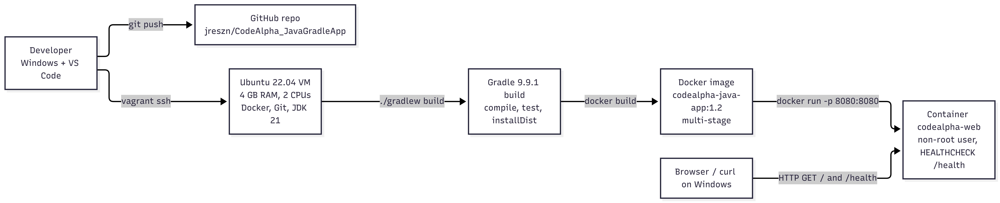

# CodeAlpha_JavaGradleApp

A Java 21 web service built with Gradle 9.9.1, packaged with a multi-stage Docker image and monitored with a health endpoint. Built as part of the CodeAlpha DevOps internship (Tasks 3 and 4).

## Features

- Java 21 application using the JDK's built-in HTTP server (no framework)
- Gradle Wrapper pinned to 9.9.1, so every build uses the same tool version
- JUnit 5 unit tests run on every build
- Multi-stage Dockerfile: build stage with Gradle, small runtime stage with a JRE
- Runs as a non-root user inside the container
- Docker HEALTHCHECK that polls `/health` every 30 seconds

## Architecture



## Endpoints

| Method | Path       | Response                                  | Content-Type                     |
|--------|------------|-------------------------------------------|----------------------------------|
| GET    | `/`        | `Hello World!`                            | `text/plain; charset=utf-8`      |
| GET    | `/health`  | `{"status":"UP"}`                         | `application/json; charset=utf-8`|

## Prerequisites

- Docker (Engine or Desktop)
- JDK 21 only if you want to run without Docker
- No Gradle install needed: the wrapper downloads the right version

## Build and test

```bash
./gradlew build
This compiles the code, runs the tests and produces the packaged app under app/build/install/app/.

Run locally (without Docker)
./gradlew run
The server listens on port 8080. Override it with the PORT environment variable:
PORT=9090 ./gradlew run

Build and run with Docker
docker build -t codealpha-java-app:1.2 .
docker run -d --name codealpha-web -p 8080:8080 codealpha-java-app:1.2

Check health:
docker inspect --format='{{.State.Health.Status}}' codealpha-web
curl -i http://localhost:8080/health

Stop and remove:
docker stop codealpha-web && docker rm codealpha-web

Versioning
Images are tagged with a version and never overwritten:
1.0 initial web server
1.1 added HEALTHCHECK
1.2 /health returns application/json
Project structure
.
├── Dockerfile                 # multi-stage image build
├── .dockerignore              # files excluded from the build context
├── settings.gradle            # project name and modules
├── gradle/
│   ├── libs.versions.toml     # central dependency versions
│   └── wrapper/               # pinned Gradle 9.9.1
└── app/
    ├── build.gradle           # Java toolchain, plugins, dependencies
    └── src/
        ├── main/java/com/codealpha/app/App.java
        └── test/java/com/codealpha/app/AppTest.java

Author
Adejare Oluwasegun Hassan

