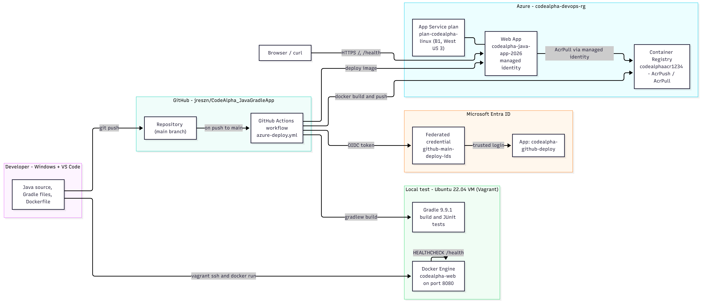
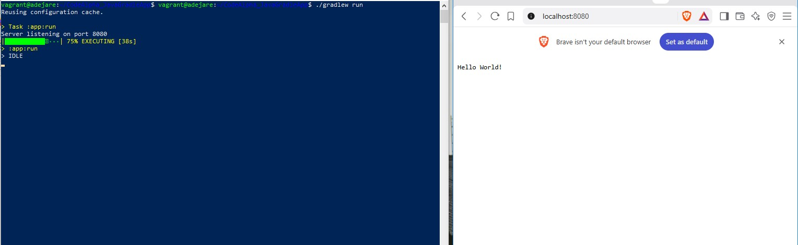
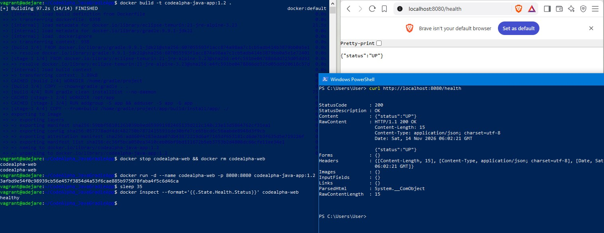
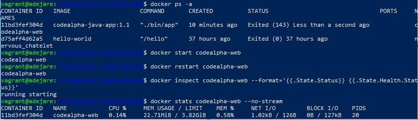
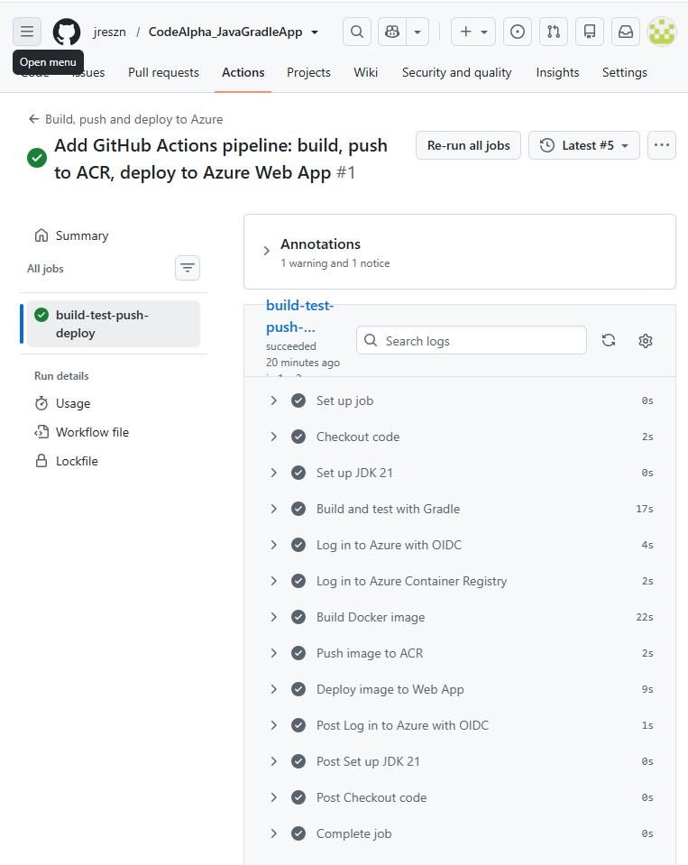
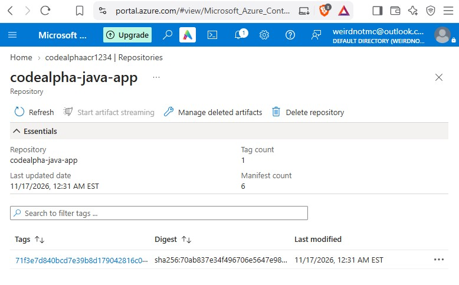
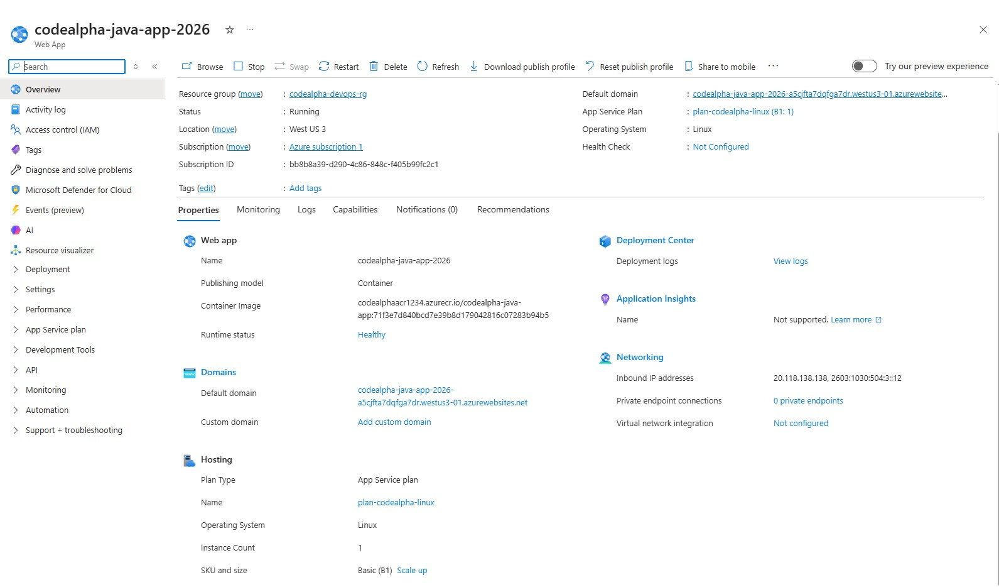
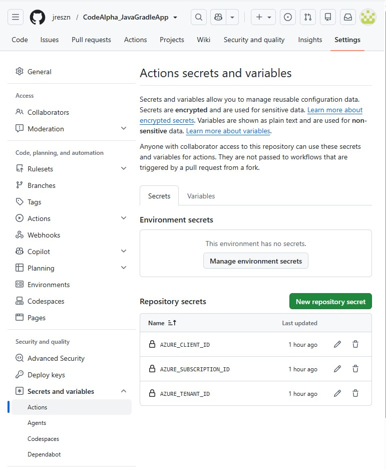
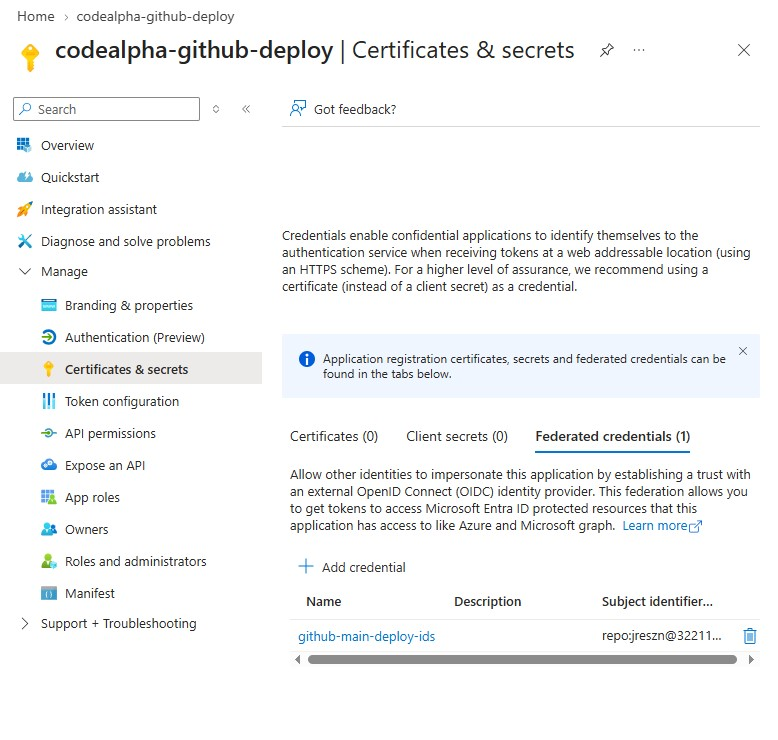
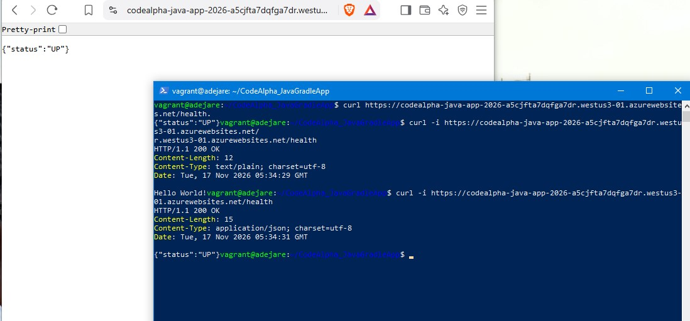

# CodeAlpha Java Gradle App

A Java 21 HTTP web service built with Gradle 9.9.1. The project includes JUnit 5 tests, a multi-stage Docker image, a `/health` endpoint, and a GitHub Actions workflow for deploying to Azure.

## Architecture



A push to `main` triggers GitHub Actions to build and test the application, authenticate to Azure using OpenID Connect (OIDC), build and push a Docker image to Azure Container Registry (ACR), and deploy that image to Azure Web App.

## Features

- Java 21 application using the JDK's built-in HTTP server (no web framework).
- Gradle Wrapper pinned to 9.9.1; a separate Gradle installation is not required.
- JUnit 5 tests run as part of the build.
- Multi-stage Docker build with a JRE-based runtime image.
- Container runs as a non-root user and has a Docker health check.
- GitHub Actions pipeline builds, tests, pushes to ACR, and deploys to Azure Web App.
- Passwordless Azure pipeline authentication with OIDC; the web app uses a managed identity to pull the image.

## Endpoints

| Method | Path      | Response          | Content type                      |
|:------:|-----------|-------------------|-----------------------------------|
| `GET`  | `/`       | `Hello World!`    | `text/plain; charset=utf-8`        |
| `GET`  | `/health` | `{"status":"UP"}` | `application/json; charset=utf-8` |

**Live app:** [Open the web app](https://codealpha-java-app-2026-a5cjfta7dqfga7dr.westus3-01.azurewebsites.net/)

**Health check:** [Open `/health`](https://codealpha-java-app-2026-a5cjfta7dqfga7dr.westus3-01.azurewebsites.net/health)

## Prerequisites

- Docker Engine or Docker Desktop to build and run the container.
- JDK 21 only if running the application directly without Docker.
- A GitHub account and an Azure subscription to use the deployment pipeline.

## Build and test

```bash
./gradlew build
```

This compiles the project, runs the tests, and creates the application distribution under `app/build/install/app/`.

## Run locally

With JDK 21 installed:

```bash
./gradlew run
```

The server listens on port `8080` by default. Set `PORT` to use another port:

```bash
PORT=9090 ./gradlew run
```

## Build and run with Docker

```bash
docker build -t codealpha-java-app:1.2 .
docker run -d --name codealpha-web -p 8080:8080 codealpha-java-app:1.2
```

Check the container health and endpoints:

```bash
docker inspect --format='{{.State.Health.Status}}' codealpha-web
curl -i http://localhost:8080/
curl -i http://localhost:8080/health
```

Stop and remove the container:

```bash
docker stop codealpha-web && docker rm codealpha-web
```

## CI/CD pipeline (Azure)

The workflow is [`.github/workflows/azure-deploy.yml`](.github/workflows/azure-deploy.yml). On every push to `main`, it:

1. Checks out the repository and configures JDK 21 (Temurin).
2. Runs `./gradlew build` and fails the workflow if the build or tests fail.
3. Authenticates to Azure with `azure/login@v2` using OIDC.
4. Logs in to ACR and builds the Docker image.
5. Tags the image with the Git commit SHA and pushes it to `codealphaacr1234.azurecr.io`.
6. Deploys that image to the Azure Web App.

### Azure resources

| Resource          | Name                       | Region    | Purpose                         |
|-------------------|----------------------------|-----------|---------------------------------|
| Resource group    | `codealpha-devops-rg`      | East US   | Holds project resources         |
| Container registry| `codealphaacr1234` (Basic) | East US   | Stores Docker images            |
| App Service plan  | `plan-codealpha-linux` (B1, Linux) | West US 3 | Hosts the web app                |
| Web app           | `codealpha-java-app-2026`  | West US 3 | Runs the container              |
| Entra app         | `codealpha-github-deploy`  | Tenant    | Pipeline identity               |

### Identities and permissions

| Identity                                      | Role         | Scope          | Purpose                              |
|-----------------------------------------------|--------------|----------------|--------------------------------------|
| `codealpha-github-deploy` service principal   | `AcrPush`     | Container registry | Pushes images                     |
| `codealpha-github-deploy` service principal   | `Contributor` | Resource group | Updates the web app                 |
| Web app system-assigned managed identity     | `AcrPull`     | Container registry | Pulls images without registry credentials |

The ACR admin user is disabled. Configure these GitHub Actions repository secrets for Azure authentication:

| Secret                 | Value                                      |
|------------------------|--------------------------------------------|
| `AZURE_CLIENT_ID`       | Application (client) ID of the Entra app   |
| `AZURE_TENANT_ID`       | Directory (tenant) ID                      |
| `AZURE_SUBSCRIPTION_ID` | Azure subscription ID                      |

The Entra app's federated credential must trust this repository and the `main` branch. The workflow does not use a stored Azure client secret.

## Screenshots

### Build and test



### Docker image and health check





### CI/CD pipeline and Azure











### Live health endpoint



## Image versions

| Version | Change                         |
|---------|--------------------------------|
| `1.0`   | Initial web server              |
| `1.1`   | Added Docker `HEALTHCHECK`      |
| `1.2`   | `/health` returns JSON          |

CI images are tagged with their Git commit SHA so deployments can be traced to a specific revision.

## Project structure

```text
.
├── .github/
│   └── workflows/
│       └── azure-deploy.yml
├── app/
│   ├── build.gradle
│   └── src/
│       ├── main/java/com/codealpha/app/App.java
│       └── test/java/com/codealpha/app/AppTest.java
├── docs/
│   ├── architecture.mmd
│   ├── images/
│   │   └── architecture.png
│   └── screenshots/
├── gradle/
│   ├── libs.versions.toml
│   └── wrapper/
├── .dockerignore
├── Dockerfile
├── gradlew
└── settings.gradle
```

## Author

Adejare Oluwasegun Hassan (`jreszn`)
